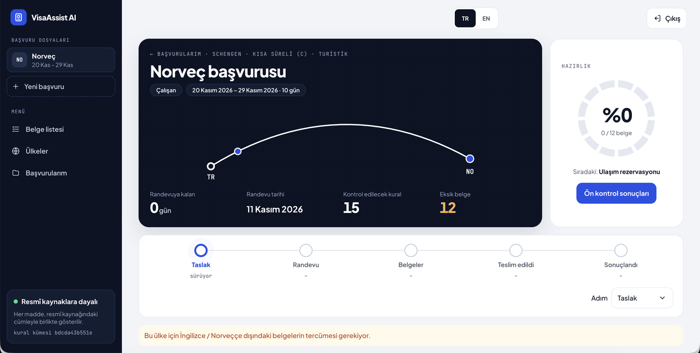

# VisaAssist AI

A web application that helps visa applicants prepare their file: a checklist taken from official
sources, with the passage each requirement comes from, and a preliminary check of the uploaded
documents against those requirements.

Istanbul Bilgi University, Computer Engineering — CMPE 491/492 Senior Design Project · Furkan Özdemir

> **Status (November 2026):** fall prototype under development. The checklist, application
> files, encrypted document upload, field entry, the rule engine and the findings page work. The
> AI layer (field extraction from documents, the source-grounded assistant, monitoring of source
> changes) is planned for spring 2027; today the applicant enters the fields by hand.
>
> VisaAssist AI helps to prepare an application. It does not predict or guarantee a visa decision.



## What it does
- **Checklist from official sources.** For a destination and a profile (employed, student) it
  lists the documents and rules, each with the official source, the section and the passage.
  Pilot scope: Schengen short-stay visa (C) for tourism, applied for in Türkiye, for the
  Netherlands and Norway ([ADR 0001](docs/decisions/0001-pilot-scope.md)).
- **Application files.** One file per trip, with dated steps and a readiness view.
- **Encrypted documents.** Upload per checklist item after consent; every document is encrypted
  with its own key, location data is removed from photos, and documents are deleted 30 days after
  the trip or at once on request ([ADR 0005](docs/decisions/0005-document-storage-and-consent.md)).
- **Preliminary check.** The applicant enters the key fields of each document; a rule engine
  reports missing documents and values that break a rule (dates, amounts, periods, names that
  differ between documents), each finding with its official source.
- **Turkish and English** interface, usable on a phone.

More screenshots: [docs/design/ui-design.md](docs/design/ui-design.md).

## Getting started
Requirements: Docker, [uv](https://docs.astral.sh/uv/) (Python 3.12) and Node.js 22.

```bash
cp .env.example .env                 # set POSTGRES_PASSWORD, keep DATABASE_URL in step with it
docker compose up -d                 # PostgreSQL with pgvector

cd backend
uv sync
uv run python -m app.storage.new_key # once; put the printed line into ../.env
uv run alembic upgrade head          # create the tables
uv run python -m app.requirements.seed   # load the requirement files
uv run uvicorn app.main:app --reload     # API on http://127.0.0.1:8000/docs
```

In a second terminal:

```bash
cd frontend
npm install
npm run dev                          # web client on http://localhost:5173
```

Details: [backend/README.md](backend/README.md), [frontend/README.md](frontend/README.md).
Use only synthetic documents: the prototype is not meant for real personal documents.

## Repository layout
| Path | Content |
| --- | --- |
| `backend/` | FastAPI service, PostgreSQL models and migrations, rule engine, tests |
| `frontend/` | React and TypeScript web client |
| `data/requirements/` | Document types, checklist items and rules, each citing a source |
| `data/sources.yaml`, `data/snapshots/` | Official sources and their weekly snapshots |
| `data/destinations.yaml` | Practical facts of applying to each destination, with sources |
| `docs/` | Requirements, design, decisions (ADR), weekly notes, related work |
| `report/` | LaTeX source of the course report |

## Checks
```bash
cd backend  && uv run ruff check . && RUN_INTEGRATION=1 uv run pytest   # needs the database
cd frontend && npm run typecheck && npm test && npm run build
```
Both run in CI on every pull request.

## Documentation
- [Requirements](docs/requirements.md) · [Roadmap](docs/ROADMAP.md)
- [Official sources](docs/sources.md) · [Requirement data](data/requirements/README.md)
- [Data model](docs/design/data-model.md) · [Interface design](docs/design/ui-design.md)
- [Architecture decisions](docs/decisions/) · [Weekly progress notes](docs/weekly/)
- [Related work](docs/related-work.md) · [How it differs from a general assistant](docs/positioning.md)

## Licence
No licence has been chosen yet.
