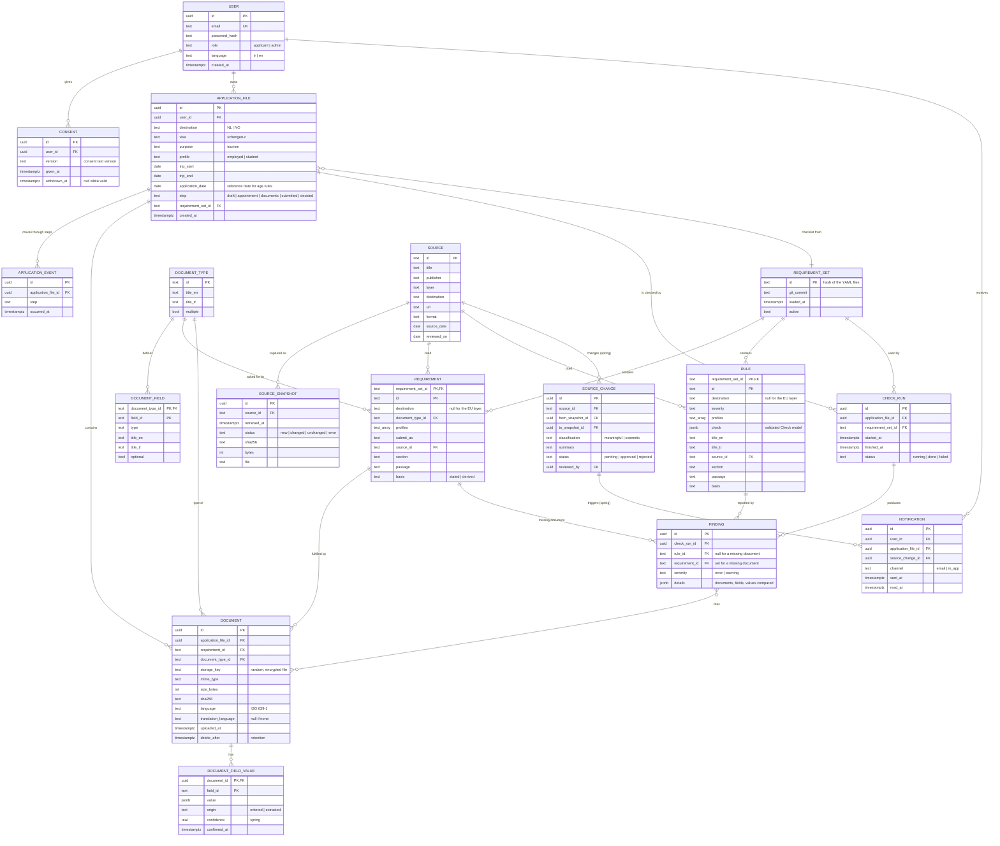

# Data Model

Version 0.1 · 2026-10-23 · Basis for the week 7 models and migrations (SQLAlchemy 2, PostgreSQL 17)

The model follows the requirement files (`data/requirements/`) and the source registry
(`data/sources.yaml`). Tables marked *spring* are designed now so that the fall schema does not
have to change shape later, but they are created only when the feature is built.

## 1. Principles
1. **YAML is the source of truth for requirements; the database holds a versioned copy.** The
   loader validates the files (`app.requirements.loader`) and writes them as one
   `requirement_set` identified by the hash of the files. A check run records the set it used, so
   an old finding can always be explained with the rule that produced it, even after a source
   change (FR-10, FR-16).
2. **Rule parameters are stored as JSON, validated by the Pydantic schema.** Twelve check kinds
   with different parameters do not get a column each; `rules.check` is `jsonb` and is only ever
   written from a validated `Check` model.
3. **Field values are typed by the document catalog.** `document_field_values.value` is `jsonb`
   holding the value in the form its field type defines (date as ISO string, money as
   `{amount, currency}`), together with where it came from: entered by the applicant (fall) or
   extracted with a confidence (spring, FR-13).
4. **Personal data is minimal and deletable** (NFR-01). Files are stored encrypted under random
   keys, never under the original file name; deleting a document removes the file, its field
   values and the findings that cite it. Application files are hard-deleted on request (FR-11).
5. **IDs:** UUIDs for everything users create; the readable text IDs of the YAML files
   (`nl-rule-photo-age`) for sources, document types, requirements and rules.

## 2. Diagram

## 3. Tables by semester

| Table | Fall | Spring | Requirement |
| --- | --- | --- | --- |
| `users`, `consents` | ✓ | | FR-04, NFR-01 |
| `application_files`, `application_events` | ✓ | | FR-05, FR-06 |
| `documents`, `document_field_values` | ✓ | extraction fields (`origin`, `confidence`) used | FR-07, FR-08, FR-13 |
| `check_runs`, `findings` | ✓ | | FR-09, FR-10 |
| `requirement_sets`, `requirements`, `rules`, `document_types`, `document_fields` | ✓ (loaded from YAML) | admin editing (FR-18, see open questions) | FR-02 |
| `sources`, `source_snapshots` | ✓ (imported from `data/`) | | NFR-03, AS3 |
| `source_changes`, `notifications` | | ✓ | FR-16, FR-17 |
| Synthetic dataset and evaluation runs | | ✓, separate `research` schema | FR-22, AS1–AS2 |

## 4. How the main flows use the model
- **Checklist (FR-02):** `requirements` of the active set where `destination` is null or the
  file's destination and the profile is in `profiles`, joined with `document_types` for titles in
  the user's language and with `sources` for the link.
- **Upload (FR-07):** a `documents` row per file, linked to the checklist item it fulfils; the
  file is encrypted and stored under `storage_key`; `delete_after` is set from the retention period.
- **Field entry (FR-08):** one `document_field_values` row per field, validated against
  `document_fields.type`; `origin = entered`, `confirmed_at` set on save.
- **Check run (FR-09, FR-10):** a `check_runs` row with the file's requirement set; every missing
  document gives a finding with `requirement_id`, every failed rule a finding with `rule_id`;
  `details` holds the documents, fields and values compared, so the finding page needs no
  re-computation.
- **Source change (spring, FR-16, FR-17):** a `source_changes` row between two snapshots; on
  approval a new requirement set is loaded; files on the old set whose findings change get a
  `notifications` row (`docs/positioning.md`, section 2.1).

## 5. Open questions
- **Retention period** for uploaded documents (NFR-01): proposal 30 days after `trip_end`, or on
  request earlier. To decide with the advisor.
- **Admin editing of requirements in spring (FR-18):** keep YAML + pull request as the only way
  (simple, reviewed, versioned) or edit in the web application and export to YAML. Decide in B9.
- **Applicant's own name variants** (e.g. Turkish characters in bookings, *Ş* vs *S*): matching
  rules belong in the rule engine, not the schema; noted here because it affects `details`.
