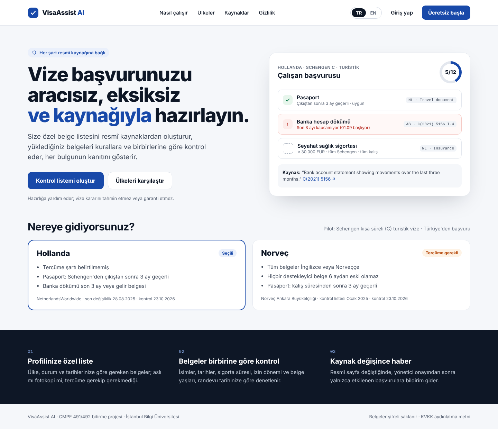
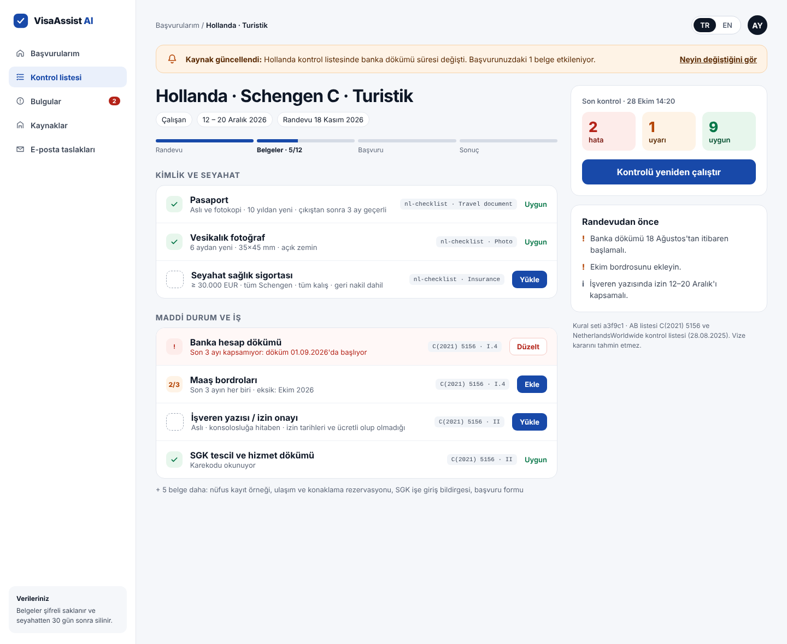
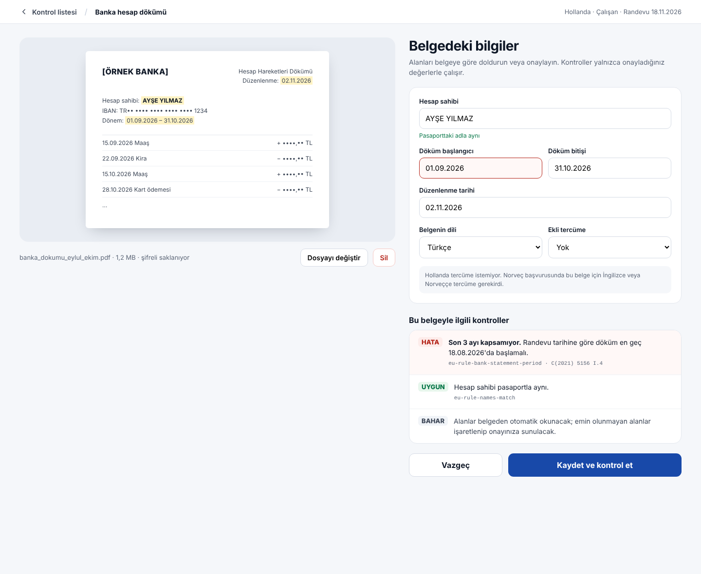
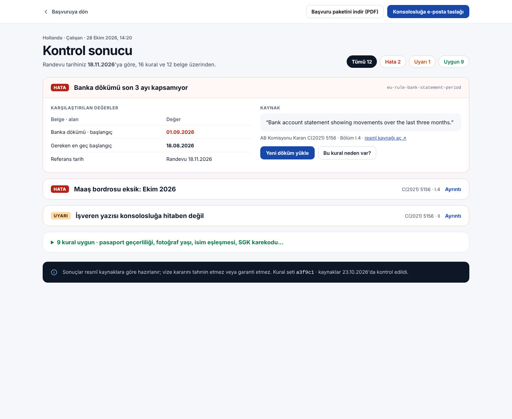
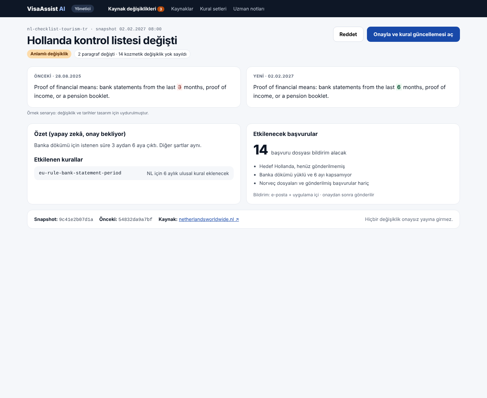
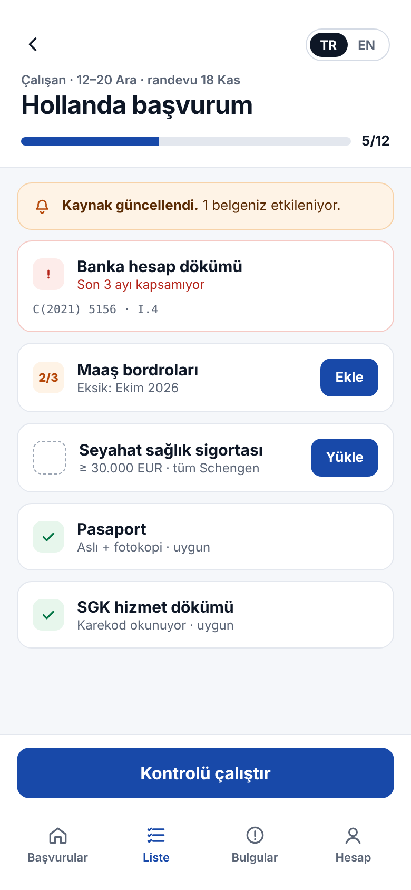
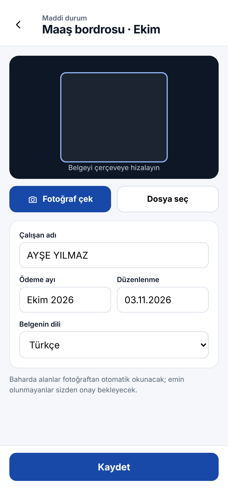
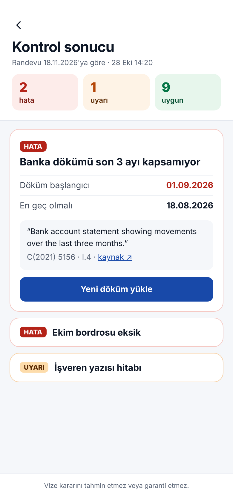
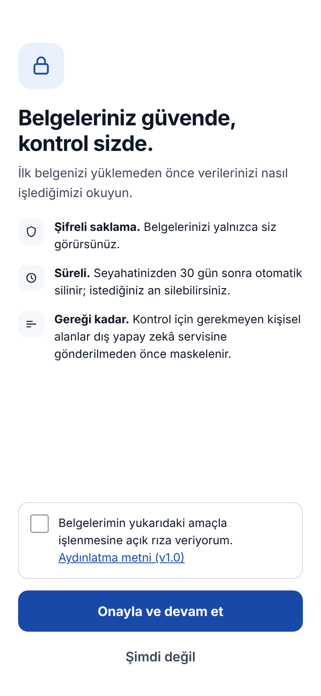

# User Interface Design

Version 0.2 · 2026-11-11 · Web and mobile screens of the fall prototype (and one spring screen)

VisaAssist AI is **one responsive web application**: the same screens run in a desktop browser
and on a phone (NFR-04); there is no separate native app. The designs below show both widths.
They are made in a design canvas; the images here are exported from it. Turkish is shown, and
every screen has the **TR | EN** switch (NFR-10). People and amounts are synthetic.

## Visual language
Revised on 11 November 2026 after the first working client looked too plain: two directions were
drawn on the design canvas and combined (layout of the second, colours of the first). The
screens below still show the first version and are replaced as pages are rebuilt.

- **Tone:** calm and trustworthy, official without being cold; evidence is always visible.
- **Layout:** a navy side panel (application files, menu, source status) on wide screens that
  becomes a floating bottom bar on a phone; content in white cards with large radii on a light
  ground; one dark "hero" card per page for the main facts.
- **Colour:** blue `#2450E6` for actions, ink `#0E1726` for text, ground `#F2F4F8`, navy
  `#0B1324` for the panel and hero cards. Status colours are reserved for state: error
  `#B42318`, warning `#B54708`, compliant `#067647`, each with a light background; text on them
  meets WCAG 4.5:1.
- **Type:** Plus Jakarta Sans for the interface; JetBrains Mono for source and rule
  identifiers, so citations read as references.
- **Motion:** entrances play once (cards rise in order, the route line draws, numbers count up,
  the readiness ring lights one segment per document); two small loops mark live state (current
  step, source status). Everything is switched off under `prefers-reduced-motion`.
- **Components:** readiness ring with one segment per checklist document; step timeline with
  dates; document table with source, submission form and status; source panel with the quoted
  passage and the link; touch targets at least 44 px.

## Screens

| # | Screen | Requirements | Width |
| --- | --- | --- | --- |
| 1 | Home and destination discovery | FR-03, NFR-03 | web |
| 2 | Application and checklist (with source-change banner) | FR-02, FR-05, FR-06, FR-17 | web |
| 3 | Document upload and fields | FR-07, FR-08 (FR-13 in spring) | web |
| 4 | Check result with evidence | FR-09, FR-10, NFR-03 | web |
| 5 | Admin: review a source change (spring; the change shown is a made-up example) | FR-16 | web |
| 6 | Checklist | FR-02, FR-07 | mobile |
| 7 | Document photo and fields | FR-07, FR-08 | mobile |
| 8 | Check result | FR-09, FR-10 | mobile |
| 9 | Consent before the first upload | NFR-01 | mobile |

### Web

### Mobile

## Design decisions
- **Evidence on every item:** checklist rows carry the source tag; a finding shows the values
  compared and the quoted passage with a link to the official page.
- **Reference date:** age rules use the appointment date, and the result page says so.
- **Consent first:** the first upload waits for consent; the 30-day retention shown is the data
  model's proposal and still open.
- **Fields from the catalog:** the field form follows `data/requirements/document-types.yaml`,
  including document language and translation (Norway rule).
- **No change without a person:** source changes reach applicants only after an administrator
  approves them.
- **Disclaimer:** home and results state that the system does not predict or guarantee a decision.
