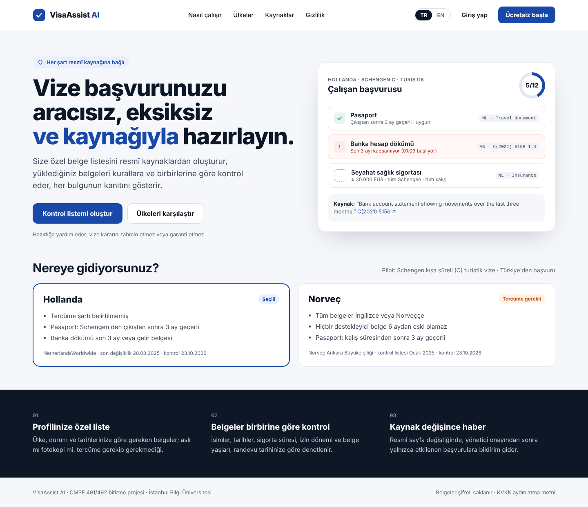
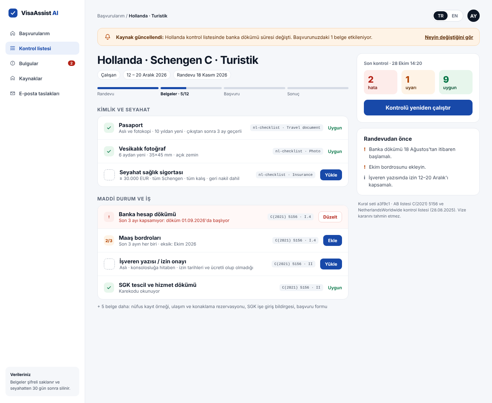
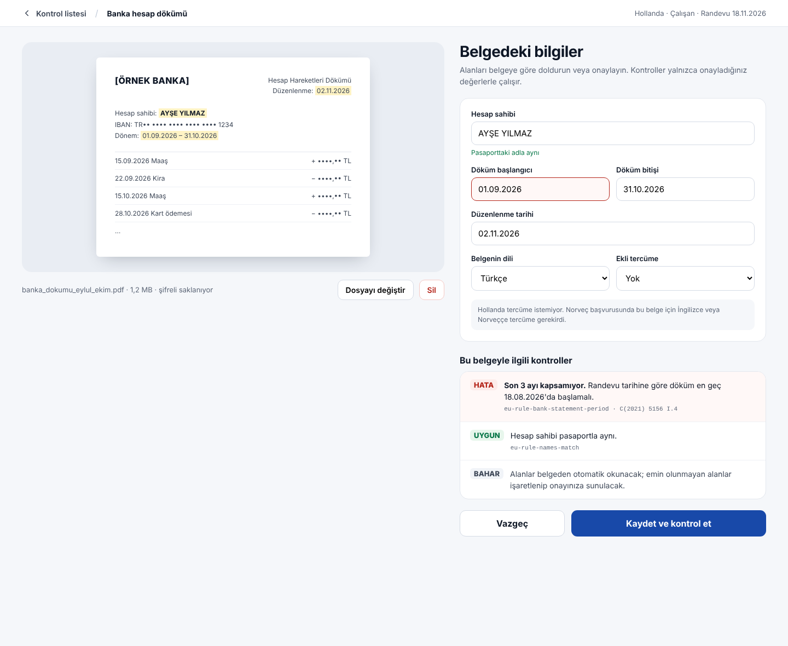
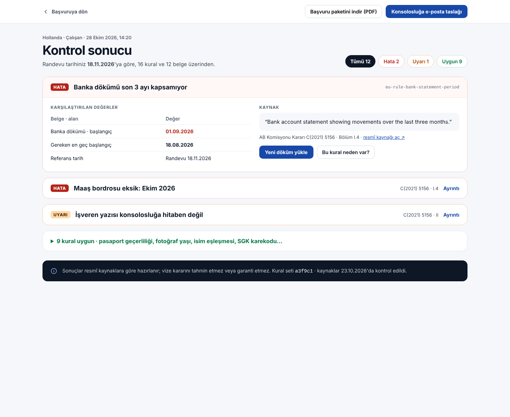
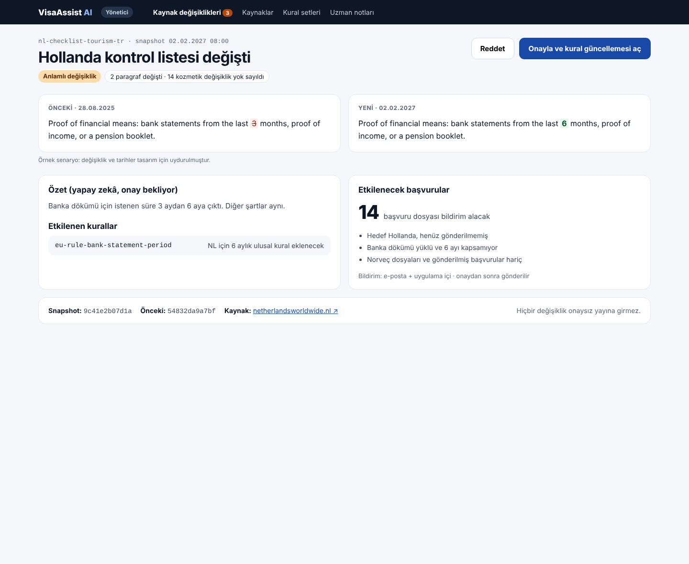
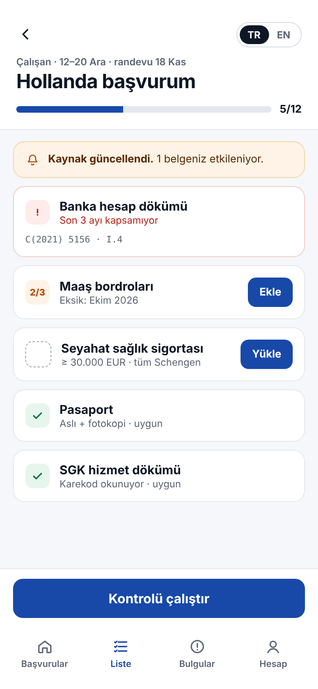
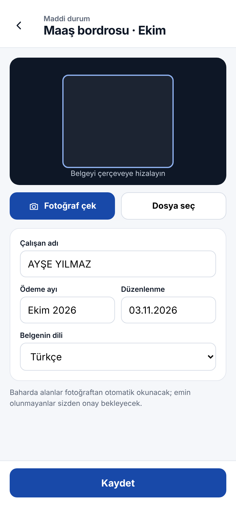
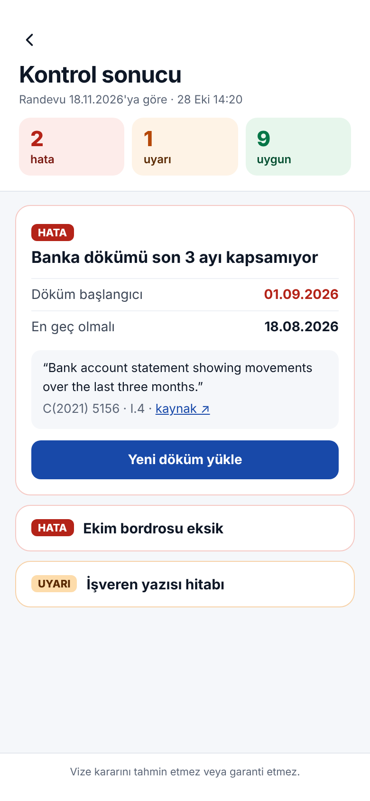
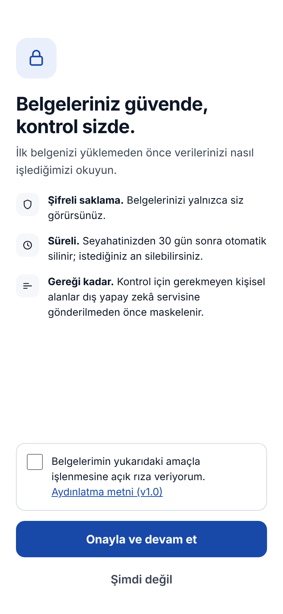

# User Interface Design

Version 0.1 · 2026-10-28 · Web and mobile screens of the fall prototype (and one spring screen)

VisaAssist AI is **one responsive web application**: the same screens run in a desktop browser
and on a phone (NFR-04); there is no separate native app. The designs below show both widths.
They are made in a design canvas; the images here are exported from it. Turkish is shown, and
every screen has the **TR | EN** switch (NFR-10). People and amounts are synthetic.

## Visual language
- **Tone:** calm and trustworthy, official without being cold; evidence is always visible.
- **Colour:** deep blue `#1849A9` for actions, ink `#0E1726` for text, light grey ground
  `#F5F7FA` with white cards. Status colours are reserved for findings: error `#B42318`,
  warning `#B54708`, compliant `#067647`, each with a light background; text on them meets
  WCAG 4.5:1.
- **Type:** Plus Jakarta Sans for the interface; JetBrains Mono for source and rule
  identifiers (`C(2021) 5156 · I.4`), so citations read as references.
- **Components:** checklist rows with status, source tag and one action; findings with the
  compared values and the quoted source passage; touch targets at least 44 px.

## Screens

| # | Screen | Requirements | Width |
| --- | --- | --- | --- |
| 1 | Home and destination discovery | FR-03, NFR-03 | web |
| 2 | Application and checklist (with source-change banner) | FR-02, FR-05, FR-06, FR-17 | web |
| 3 | Document upload and fields | FR-07, FR-08 (FR-13 in spring) | web |
| 4 | Check result with evidence | FR-09, FR-10, NFR-03 | web |
| 5 | Admin: review a source change (spring; the change shown is a made-up example) | FR-16 | web |
| 6 | Checklist | FR-02, FR-07 | mobile |
| 7 | Document photo and fields | FR-07, FR-08 | mobile |
| 8 | Check result | FR-09, FR-10 | mobile |
| 9 | Consent before the first upload | NFR-01 | mobile |

### Web

### Mobile

## Design decisions
- **Evidence on every item:** checklist rows carry the source tag; a finding shows the values
  compared and the quoted passage with a link to the official page.
- **Reference date:** age rules use the appointment date, and the result page says so.
- **Consent first:** the first upload waits for consent; the 30-day retention shown is the data
  model's proposal and still open.
- **Fields from the catalog:** the field form follows `data/requirements/document-types.yaml`,
  including document language and translation (Norway rule).
- **No change without a person:** source changes reach applicants only after an administrator
  approves them.
- **Disclaimer:** home and results state that the system does not predict or guarantee a decision.
